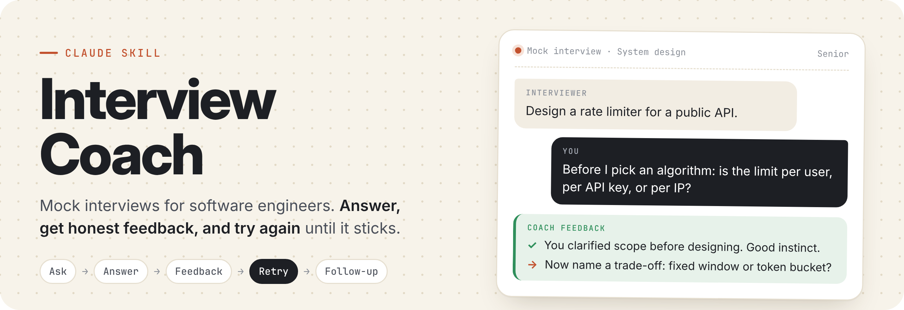

<p align="center">
  
</p>

# Interview Coach

A [Claude skill](https://support.claude.com/en/articles/12512180-using-skills-in-claude) that turns Claude into a mock interviewer and coach for software engineering interviews.

It doesn't just hand you a list of questions. It runs the session like a real interviewer: asks one question, lets you answer, gives you specific feedback, has you try again, then pushes with a follow-up. Most of the improvement comes from that retry, so the skill always includes it.

## What it covers

| Topic | What you practice | Bank size |
|---|---|---|
| **System design** | Notification systems, rate limiters, file uploads, search, URL shorteners, leaderboards, video pipelines, durable workflows, LLM review pipelines | 10 questions |
| **Testing strategy** | The testing pyramid, mocking vs. real dependencies, contract tests, snapshot tests, testing LLM code, TDD | 11 questions |
| **Scalability and performance** | Caching, horizontal vs. vertical scaling, read replicas, slow queries, write bottlenecks, WebSockets vs. polling, designing for failure | 10 questions |
| **Architecture patterns** | Monolith vs. microservices, event-driven design, idempotency, consistency models, REST/GraphQL/gRPC, multi-tenancy, auth, secrets | 12 questions |
| **SOLID and OOP design** | All five principles (with violations, fixes, and when *not* to apply them), plus cross-cutting questions and five code-review exercises | 5 principles + 15 extras |
| **CS fundamentals** | Big-O, data structures, algorithms, "talk it through" problems, concurrency, memory, OS, networking, databases, security, engineering practice | 100+ questions |
| **Behavioral (STAR)** | Technical decisions, conflict, mentoring, incidents, failures | 19 questions |
| **HR / recruiter screen** | "Tell me about yourself", why this role, why you're leaving, salary expectations, availability, questions for the recruiter | 10 questions |

You can also ask for:

- **A mixed mock interview** that pulls questions from several topics.
- **Job posting mode.** Paste a job posting or link and the coach pulls out the stack and responsibilities, gives you an honest fit assessment (strong matches, adjacent experience, real gaps), and builds a practice plan for that role.
- **Learn mode.** "Teach me X, then quiz me on it."

Every question in the banks comes with notes on what a strong answer contains, so the feedback is checked against real material instead of made up on the spot.

## How a session works

**1. Setup.** The coach asks what you want to practice, your level (junior, mid, senior, staff), your main stack, and what to call you. Then it asks you to describe 3 to 5 real projects you've worked on. It uses those later in feedback ("your payments project is a perfect example here"), and it will never invent experience for you.

**2. The practice loop.** Each question goes through these steps:

```
Ask ─► Structure hint ─► You answer ─► Feedback ─► You answer again ─► Feedback on what changed ─► Follow-up probe ─► Next question
```

- **Ask:** one question, asked cold, the way a real interviewer would.
- **Structure hint:** a one-line reminder of the shape of a good answer (for example, "clarify scope, name components, one trade-off each"). Say *hard mode* to turn it off.
- **Feedback:** what was strong (named specifically), what was missing, and one or two fixes you can apply right away.
- **Retry:** you answer the same question again with the feedback applied.
- **Follow-up:** a probing question about the weakest part of your answer, such as "what happens if that worker crashes halfway?"

If you get stuck or say "I don't know," the coach switches to guided teaching. It builds the answer with you step by step, then asks the original question again so you can say it in your own words.

**3. Wrap-up.** When you're done, you get two or three things you did well, the recurring patterns that held you back (for example, "you skipped the trade-off on three questions"), and a suggested focus for next time.

## Installation

### Claude (web and desktop apps)

1. Download [`interview-coach.skill`](./interview-coach.skill) from this repo. It's a zip of the skill folder, ready to upload.
2. In Claude, go to **Customize → Skills**, click **+**, then **Create skill → Upload a skill**, and select the file. (On older versions of the interface it's **Settings → Capabilities → Skills → Upload skill**.)
3. Make sure code execution is turned on. Custom skills require a Pro, Max, Team, or Enterprise plan.

See Anthropic's guide, [Using Skills in Claude](https://support.claude.com/en/articles/12512180-using-skills-in-claude), for the current steps.

### Claude Code

To make it available in every project, clone it into your personal skills folder:

```bash
git clone https://github.com/guibyui/interview-coach.git ~/.claude/skills/interview-coach
```

To make it available in one project only, clone it into that project's `.claude/skills/` folder:

```bash
git clone https://github.com/guibyui/interview-coach.git .claude/skills/interview-coach
```

Run `git pull` inside that folder later to get updates.

## Usage

You don't have to name the skill. Just ask for interview practice and Claude picks it up. Some ways to start:

- `Interview me.`
- `Run a mock system design interview. I'm a senior backend engineer, mostly Go and Postgres.`
- `Help me prepare for this job posting:` (then paste the text or a link)
- `Quiz me on SOLID principles, hard mode.`
- `Teach me database isolation levels, then quiz me.`
- `I have a recruiter screen with Acme on Friday. Practice the HR screen with me.`
- `Give me a mixed technical mock interview, mid level, TypeScript.`

### Tips

- **Use real stories.** Answers grounded in your own projects are always stronger than textbook ones. If the coach shows you a sample answer, it labels it as an example. Rewrite it with something that's actually true for you.
- **Do the retry.** Most of the learning happens on the second attempt.
- **Ask for a model answer** whenever you want one. Otherwise the coach only gives one if you're still stuck after a nudge.
- **Voice works too.** The coach keeps spoken turns short, waits for you to finish when you pause to think, and doesn't penalize you for transcription errors.
- **Save your progress.** If Claude can write files, it will offer to save a `candidate-profile.md` (so the next session can skip setup), a practice log, and a one-page plan for each job posting.
- **Compensation and personal decisions stay yours.** For salary and "why are you leaving," the coach helps you structure and frame the answer but won't pick the numbers or reasons for you.

## Repository layout

```
interview-coach/
├── SKILL.md                              # Entry point: coach persona, session flow, principles
├── interview-coach.skill                 # Packaged zip for uploading to Claude
├── assets/                               # README banner, social preview, Agensi logo and preview, and their HTML source
└── references/
    ├── practice-loop.md                  # Full loop, grading rubric, common traps, coaching moves
    ├── candidate-profile-template.md     # What to collect about your real projects
    ├── job-posting-mode.md               # Turning a job posting into a practice plan
    ├── hr-screen.md                      # Recruiter screen questions and coaching notes
    └── questions/
        ├── system-design.md
        ├── testing.md
        ├── scalability.md
        ├── architecture-patterns.md
        ├── solid-principles.md
        ├── cs-fundamentals.md
        └── behavioral-star.md
```

Claude reads `SKILL.md` first and loads the reference files only when needed. For example, it reads only the question bank for the topic you picked.

## Customizing

The question banks are plain Markdown, so they're easy to extend. To add a question, follow the format of the file you're editing. Most banks use a numbered heading and a "Key points" line:

```markdown
### 11. How would you design a feature flag system?
Key points: what a strong answer should mention, the trade-offs to elicit, and common mistakes.
```

The key points matter: they're what the coach uses to judge answers, so keep them accurate.

If you edit the skill and want to upload your version to the Claude apps, rebuild the `.skill` file from the folder that contains your clone:

```bash
zip -r interview-coach.skill interview-coach/SKILL.md interview-coach/references
```

## Contributing

Issues and pull requests are welcome, especially new questions, corrections to key points, and feedback from real interviews about what worked and what didn't.
